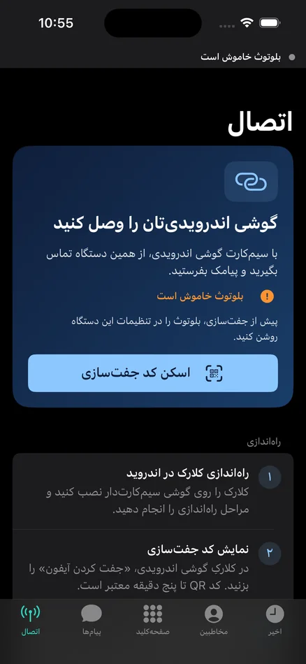
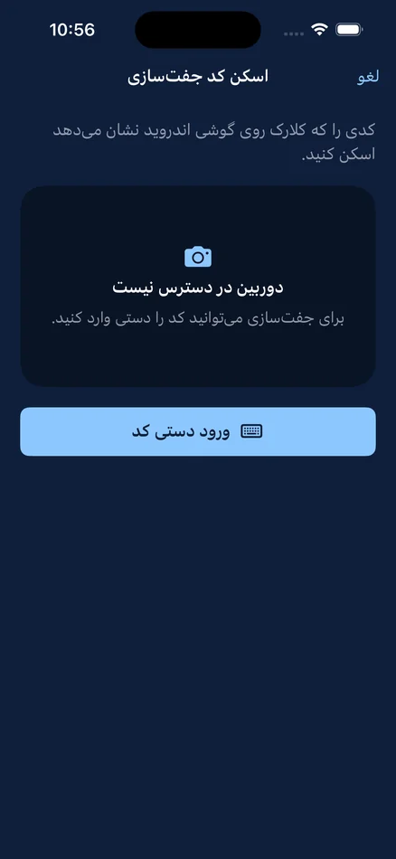
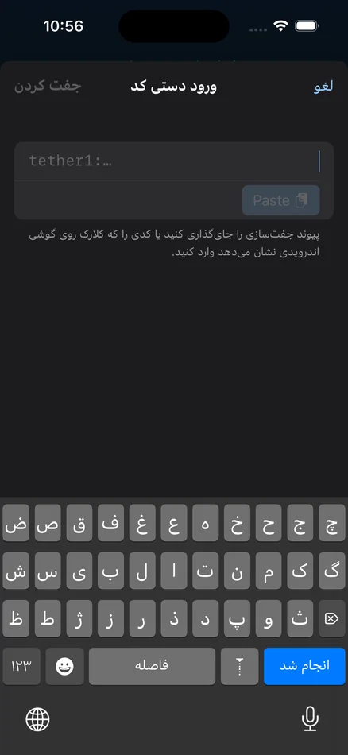

# کلارک | Clark

**تماس و پیامک سیم‌کارت اندروید، روی آیفون، آیپد یا یک گوشی اندرویدی دیگر.**

کلارک گوشی اندرویدیِ سیم‌کارت‌دار را به دستگاه دوم وصل می‌کند تا بتوانید از آن دستگاه تماس بگیرید، پیامک بفرستید و مخاطبان و سابقهٔ تماس را ببینید. جفت‌سازی با QR انجام می‌شود. دستگاه‌ها از طریق بلوتوث مستقیم به هم وصل می‌شوند و ارتباط رمزنگاری سرتاسری دارد. برای اتصال نیازی به حساب کاربری یا سرور نیست.

## پیش‌نمایش آیفون

<table>
  <tr>
    <th>اتصال گوشی اندرویدی</th>
    <th>اسکن کد جفت‌سازی</th>
    <th>ورود دستی کد</th>
  </tr>
  <tr>
    <td></td>
    <td></td>
    <td></td>
  </tr>
</table>

تصاویر از [اجرای کلارک در شبیه‌ساز آیفون](https://github.com/ashkan0033/tether/actions/runs/45601031152) گرفته شده‌اند. شبیه‌ساز دوربین ندارد، برای همین تصویر دوم مسیر ورود دستی را در حالت نبود دوربین نشان می‌دهد.

## وضعیت توسعه

| بخش | وضعیت |
| --- | --- |
| آیفون | بیلد بدون امضا با Xcode و تست‌های خودکار اپ روی شبیه‌ساز موفق بوده‌اند |
| اندروید | APK آزمایشی میزبان و همراه ساخته شده و تست‌های خودکار اندروید موفق بوده‌اند |
| تست روی گوشی واقعی | جفت‌سازی بلوتوث، تماس ورودی و خروجی، صدای دوطرفه، پیامک و اتصال مجدد هنوز باید بررسی شوند |
| انتشار | فایل نصب رسمی کلارک هنوز در GitHub Releases منتشر نشده و بیلد آزمایشی آیفون برای نصب روی گوشی به امضا نیاز دارد |

[شاخهٔ توسعه](https://github.com/ashkan0033/tether/tree/clark/app-branding) · [تغییرات در دست بررسی](https://github.com/ashkan0033/tether/pull/1) · [نتیجهٔ بیلد و تست‌ها](https://github.com/ashkan0033/tether/actions/runs/45600836462)

## دستگاه‌ها و سازگاری

| دستگاه | نقش | حداقل نسخه |
| --- | --- | --- |
| گوشی اندرویدی سیم‌کارت‌دار | میزبان تماس و پیامک | Android 8 با پشتیبانی از Bluetooth LE advertising |
| آیفون یا آیپد | دستگاه دوم برای تماس، پیامک و مخاطبان | iOS یا iPadOS 16 |
| گوشی اندرویدی دوم | همان نقش، با اپ کلارک همراه | Android 10 |

صدای دوطرفه به نسخهٔ اندروید و مدل گوشی میزبان بستگی دارد. [جدول سازگاری اندروید و تماس صوتی](docs/devices/android-versions.md)

## جفت‌سازی

1. روی گوشی اندرویدی سیم‌کارت‌دار، کلارک را اجرا کنید و مراحل راه‌اندازی میزبان را انجام دهید.
2. در اپ میزبان، «جفت کردن آیفون» را بزنید تا QR نمایش داده شود.
3. در آیفون، زبانهٔ «اتصال» و سپس «اسکن کد جفت‌سازی» را باز کنید. در گوشی اندرویدی دوم، از اسکنر کلارک همراه استفاده کنید. در آیفون، ورود دستی کد هم در دسترس است.

[راهنمای کامل راه‌اندازی](docs/SETUP.md) · [راهنمای کلارک همراه](docs/ANDROID-CLIENT.md)

## ساخت از سورس

```bash
git clone --branch clark/app-branding https://github.com/ashkan0033/tether.git clark
cd clark
```

### اندروید

پیش‌نیازها JDK 17، پلتفرم Android SDK 36 و Build Tools 35.0.0 هستند. پروژه از Gradle Wrapper استفاده می‌کند.

```bash
cd android
./gradlew :app:assembleDebug :client:assembleDebug
```

در PowerShell ویندوز از `.\gradlew.bat :app:assembleDebug :client:assembleDebug` استفاده کنید. خروجی‌ها در `android/app/build/outputs/apk/debug/` و `android/client/build/outputs/apk/debug/` قرار می‌گیرند.

### آیفون و آیپد

برای ساخت اپ به macOS، Xcode و XcodeGen نیاز دارید. در شاخهٔ توسعه، پوشهٔ `ios` را باز کنید و `xcodegen generate` را اجرا کنید. پروژهٔ `Tether.xcodeproj` و Scheme داخلی `Tether` برای بیلد کلارک استفاده می‌شوند. برای اجرای روی آیفون واقعی، تنظیمات امضای Apple را مطابق [راهنمای بیلد](docs/BUILD.md) انجام دهید.

## ساختار مخزن

| مسیر | کاربرد |
| --- | --- |
| `android/app` | اپ میزبان روی گوشی سیم‌کارت‌دار |
| `android/client` | اپ کلارک همراه روی گوشی دوم اندرویدی |
| `ios/Tether` | اپ کلارک برای آیفون و آیپد |
| `android/core`، `ios/TetherCore` و `protocol` | کتابخانه‌ها و پروتکل ارتباطی |

[راهنمای بیلد و تست](docs/BUILD.md) · [گزارش خطا](https://github.com/ashkan0033/tether/issues)

## About Clark

Clark brings calls, SMS, contacts, and call history from a SIM-equipped Android host to an iPhone, iPad, or a second Android phone over an encrypted Bluetooth connection. The project is in development. Android debug builds and iOS simulator tests are available for development, and physical-device testing is pending.

کلارک بر پایهٔ [Tether، پروژهٔ amirwmr و مشارکت‌کنندگان](https://github.com/amirwmr/tether) توسعه داده می‌شود و تحت [مجوز MIT](LICENSE) است.
